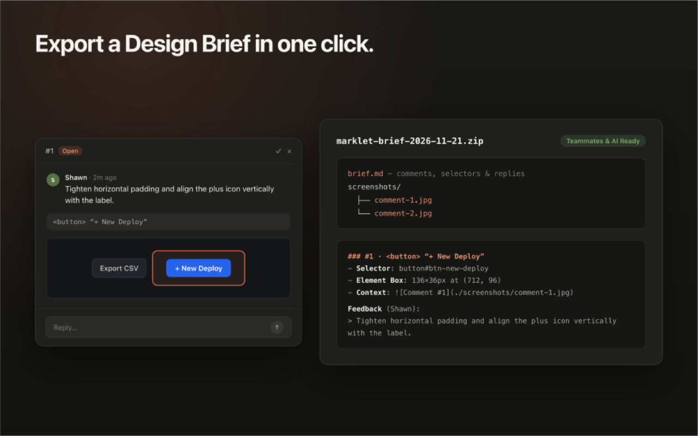

# Marklet — Visual Comments for Async and AI Workflows

Leave element-level comments on any webpage or local HTML prototype for async design feedback, team handoff, and agentic workflows.

Built as a lightweight Chrome / Microsoft Edge Manifest V3 extension (TypeScript + Vite + Preact) with an isolated Shadow DOM overlay, automatic Light & Dark mode, and a strict least-privilege security model.

[](https://microsoftedge.microsoft.com/addons/detail/marklet-%E2%80%94-visual-comments/pbalkephghpppkgfamcamkflfmnmcghl)


<p align="center">
  
  
</p>

## Highlights
- **Explicit, least-privilege activation**: Uses only `activeTab`, `scripting`, and `storage` — zero `<all_urls>`, zero background tab monitoring, zero network requests. Marklet never touches a page until you click **Start Review**.
- **Resilient element anchoring**: Composite DOM anchoring (`data-testid` → stable `id` → semantic CSS selector → structural path + text/geometry fallback) with modal/dialog context detection.
- **Visual element snapshots**: Automatically captures a cropped screenshot of the target element with a clean highlight frame for every comment.
- **Export Design Brief (`.zip`)**: One-click export of `brief.md` + cropped element screenshots — ready to share with teammates or drop straight into AI coding tools (Antigravity, Cursor, Claude, Codex).
- **Light & Dark mode**: Automatically adapts to your OS appearance.
- **Works on web pages & local `file://` prototypes**: Review production sites, staging links, or local HTML files.

## Architecture (3 Decoupled Layers)

```
src/
├── core/                    # Pure UI commenting engine (zero chrome.* APIs)
│   ├── anchor.ts            # ElementPicker + composite anchor generation & resolution
│   ├── OverlayApp.tsx       # Shadow DOM toolbar, comment cards, and Comments sidebar
│   ├── overlay.css          # Injected inline into ShadowRoot (Light & Dark themes)
│   ├── exportPrompt.ts      # Markdown & .zip Design Brief generator
│   └── zip.ts               # Zero-dependency ZIP archive builder
├── adapters/                # Pluggable persistence & identity contracts (zero chrome.*)
│   ├── types.ts             # StorageAdapter, AuthAdapter, CommentThread, ElementAnchor
│   ├── localStorageAdapter.ts
│   └── authAdapter.ts
└── extension/               # Chrome / Edge MV3 shell
    ├── manifest.json        # Least-privilege MV3 (activeTab, scripting, storage)
    ├── background.ts        # On-demand injection, viewport capture, per-tab badge
    ├── content.ts           # ShadowRoot + Popover API Top Layer host
    ├── chromeStorageAdapter.ts
    ├── popup.html / popup.tsx
    └── icons/
```

Dependency boundaries are enforced at build time by `scripts/check-layers.mjs` (`core` and `adapters` cannot import `chrome.*`), making it easy to plug in an enterprise REST/WebSocket backend, SSO identity provider, or VS Code Webview shell later.

## Install

- **Microsoft Edge**: [Install from Microsoft Edge Add-ons](https://microsoftedge.microsoft.com/addons/detail/marklet-%E2%80%94-visual-comments/pbalkephghpppkgfamcamkflfmnmcghl)
- **Google Chrome**: Chrome Web Store submission in review (or load unpacked from `dist/` below)

## Development

```bash
npm install
npm run build      # Layer check + TypeScript typecheck + Vite build -> dist/
npm run package    # Build + zip dist/ -> release/marklet-v<version>.zip
npm run dev        # Development build with inline sourcemaps
```

### Load Unpacked in Chrome / Edge
1. Open `chrome://extensions` (or `edge://extensions`) and enable **Developer mode**.
2. Click **Load unpacked** and select the `dist/` directory.
3. *(Optional for local HTML files)* Open **Details** → enable **Allow access to file URLs**.
4. Open any webpage (or `demo/test-prototype.html`), click the **Marklet** toolbar icon, and choose **Start Review**.

## Privacy & Security
Marklet makes **zero network requests** and stores all comments and screenshots locally in your browser via `chrome.storage.local`. See [PRIVACY.md](./PRIVACY.md) for full details.

## Feedback & Author
Built by Shawn Deng ([@shawnzpdeng](https://x.com/shawnzpdeng)). Have ideas or bug reports? Feel free to open a GitHub Issue or say hi on X!
